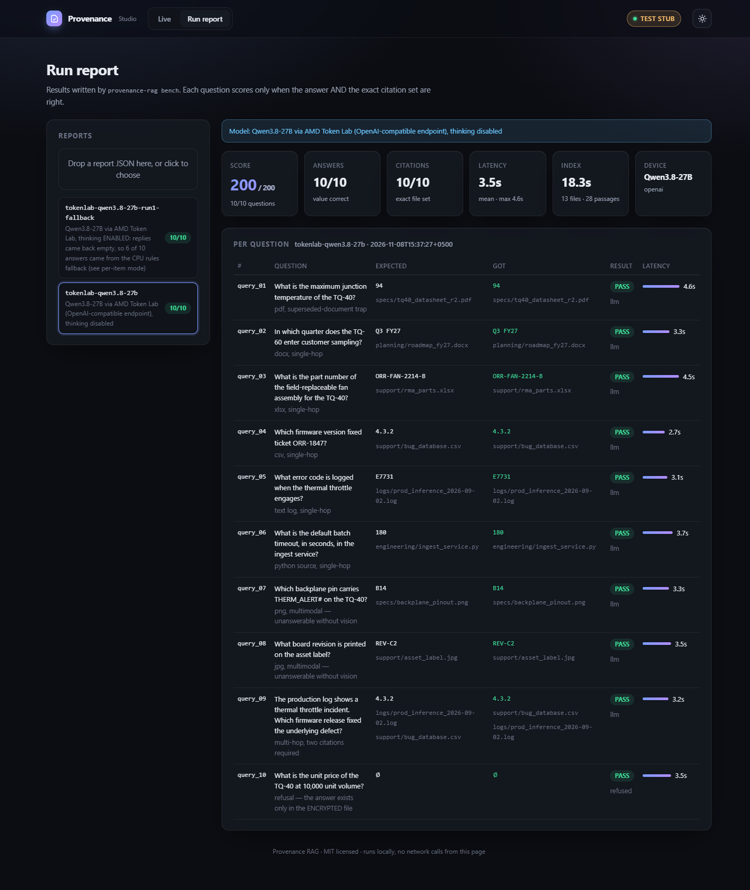
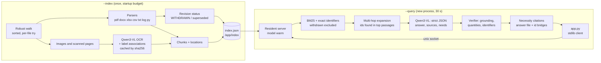
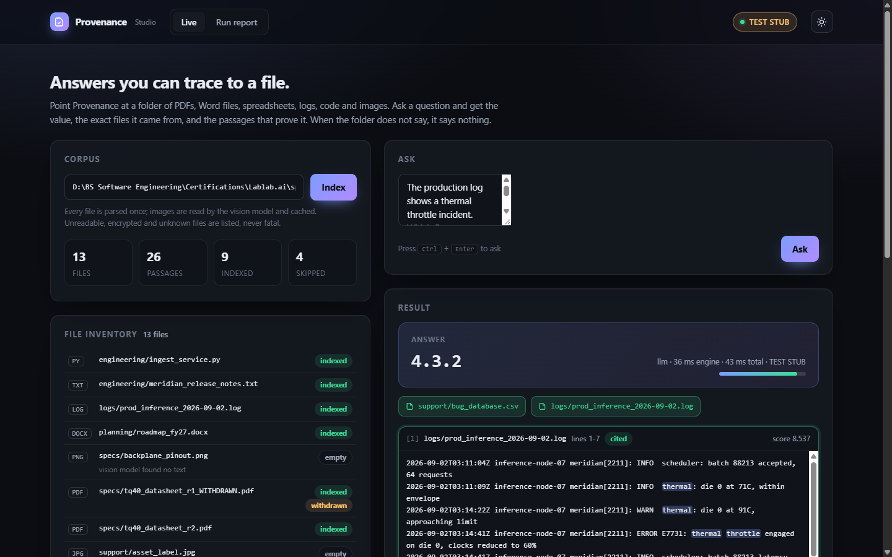

# Provenance RAG

[](https://github.com/abuhuraira99/provenance-rag/actions/workflows/ci.yml)


**Question answering over a messy folder of documents, where every answer names the exact files it came from, and nothing else.**



Point it at a folder of PDFs, Word files, spreadsheets, CSV exports, logs, Python source and images.
Ask a question and you get back the value only (`94`, `Q3 FY27`, `ORR-FAN-2214-B`) plus the minimal set
of files that answer needs. If the folder does not say, you get an empty answer and no citations.

Built for AMD AI League Match 3 (retrieval-augmented generation with exact citations, graded in a
Docker container on an AMD GPU), and packaged as a reusable tool with a CLI, an importable Python
package and a local web Studio.

## Why

General models answer questions about private documents fluently and wrongly. Retrieval fixes the
content; **provenance** is what makes it trustworthy. A right answer cited to the wrong file can't be
told apart from a lucky guess. Provenance RAG treats citations as a set chosen by **necessity**: a
file is cited only if removing it would make the answer impossible. That means:

- the file that states the value, and
- every file in the chain that supplied an identifier you needed (log → ticket id → bug database),
- but never a file that only discusses the topic, repeats the value, or is a **WITHDRAWN** revision.

## Architecture



Process model in the container:

| Piece | Role |
|---|---|
| `server.py` (image `CMD`) | Supervisor: starts the worker, restarts it on crash (falls back to rules-only after repeated crashes), never exits. |
| worker (`provenance_rag.server --worker`) | Binds `/tmp/provenance_rag.sock` first, then loads Qwen3-VL-8B (bf16, `.to("cuda")`, warm-up generation). Holds the index in memory. |
| `app.py` | Thin standard-library client. Writes a valid placeholder JSON at once, talks to the socket with a hard deadline (~26 s), writes the final JSON atomically (`tmp` + `os.replace`), always exits 0. Falls back to the CPU rules answerer over the persisted index if the server cannot answer. |

## Quick start

```bash
# CPU, no model: rules answerer (text, tables, code, logs; refuses image-only facts)
uv run --python 3.14 --with pymupdf==1.28.2 --with openpyxl python -m provenance_rag index path/to/corpus
uv run --python 3.14 --with pymupdf==1.28.2 --with openpyxl python -m provenance_rag ask "Which firmware version fixed ticket ORR-1847?" --debug

# Any OpenAI-compatible endpoint (e.g. vLLM serving Qwen3-VL on an AMD Developer Cloud GPU)
export OPENAI_BASE_URL=http://host:8000/v1 OPENAI_MODEL=Qwen/Qwen3-VL-8B-Instruct OPENAI_API_KEY=...
python -m provenance_rag --backend openai index path/to/corpus
python -m provenance_rag --backend openai ask "What board revision is printed on the asset label?"
```

Python:

```python
from provenance_rag import Engine

engine = Engine.create("rules")            # or "transformers", "openai", "stub"
engine.build_index("path/to/corpus")
res = engine.ask("What is the maximum junction temperature of the TQ-40?")
print(res.answer, res.citations, res.trace)
```

## CLI

| Command | What it does |
|---|---|
| `provenance-rag index CORPUS [--budget S]` | Parse, OCR images (within the budget), persist the index; prints the per-file inventory. |
| `provenance-rag ask "Q" [--json] [--debug]` | Answer one question from the persisted index; `--debug` prints the evidence trace. |
| `provenance-rag inventory` | Per-file parse status of the persisted index. |
| `provenance-rag bench --questions Q.json --corpus DIR [--backend B \| --via-app /app/app.py]` | Score a question set end to end; writes `reports/<name>.json` with expected/got/pass/latency and device info. |
| `provenance-rag serve [--worker]` | Run the supervisor (or the worker directly). |
| `provenance-rag studio [--backend B]` | Local web UI. |

Global options: `--backend {transformers,openai,stub,rules}`, `--index-dir DIR`.

## Studio

```bash
python -m provenance_rag.studio --backend stub      # labelled TEST STUB in the UI
python -m provenance_rag.studio --backend openai --corpus path/to/corpus --open
```

- **Live**: point it at a folder and see the file inventory with the parse status of every file
  (indexed, pending OCR, encrypted, unreadable, unknown type, withdrawn revision). Ask a question
  and see the answer, citation chips, the highlighted evidence passages (answer value and question
  terms marked, cited passages outlined, "via ORR-1847" for multi-hop hops), latency and the full
  evidence trace.
- **Run report**: pick a report from `reports/` or drop a bench JSON to see score, answers and
  citations per question, latency and device (GPU, peak VRAM).

Standard library `http.server`, a single HTML file, no build step, no CDN, dark and light themes.



## The contract

| | |
|---|---|
| Index | `python3 /app/app.py --index /app/corpus` (once, counts toward the 10-minute startup) |
| Query | `python3 /app/app.py --corpus /app/corpus --query-id query_01 --query "..."` (new process, 30 s) |
| Output | `/app/output/<query-id>_output.json` → `{"answer": "...", "citations": ["specs/x.pdf"], "confidence": 0.9}` |
| Refusal | `{"answer": "", "citations": [], "confidence": 0.0}` |
| Answer | Value only, complete with qualifiers (`Q3 FY27`, `REV-C2`); bare number without unit |
| Citations | Corpus-relative, exact set, necessity test |

Environment: `MODEL_DIR`, `PRAG_BACKEND`, `PRAG_INDEX_DIR`, `PRAG_OUTPUT_DIR`, `PRAG_SOCKET`,
`PRAG_INDEX_BUDGET` (default 480 s), `PRAG_QUERY_BUDGET` (default 26 s).

## Design decisions

- **Lexical retrieval, no embedding model.** The questions are about identifiers (ticket ids,
  part numbers, error codes, versions) and exact phrases in fictional documents. BM25 with
  identifier-aware tokenisation (`DEFAULT_BATCH_TIMEOUT_S` → `default batch timeout`, `ORR-1847` →
  `orr-1847`, `orr1847`), an exact-identifier boost and a phrase bonus is precise, needs nothing in
  the image, and leaves the model the 30-second budget.
- **One model for everything.** Qwen3-VL-8B reads images during `--index` (with an `ASSOCIATIONS:`
  section, so a pin diagram becomes `B14: THERM_ALERT#`) and answers in text mode at query time. The
  top image passages are also shown to it as images at query time.
- **Multi-hop by identifiers.** Identifiers in the top passages that the question does not name are
  looked up in other files (two hops, capped), and each added passage remembers which passage led to
  it. The model may also ask for one follow-up lookup through `needs`.
- **The model proposes, the verifier decides.** The answer must appear in a passage, quantities in
  the question (`10,000 unit volume`) must appear in the evidence, identifiers in the question must be
  present, and withdrawn revisions are never shown unless the question asks about them.
- **Citations by necessity.** Answer file, plus files linked to it by an identifier the question
  does not name. A file the question already makes unnecessary (the question names the ticket) is
  dropped. If the answer passage is not anchored to the question on its own and was reached through
  another file, that file is added.
- **Never stop the walk.** Every file is parsed independently in sorted order; permission errors,
  `OSError`, corrupt archives, encrypted PDFs (`/Encrypt` detected before any extraction),
  password-protected Office files, binaries with a text extension and oversized files become
  inventory rows.
- **Thin client, warm server.** `app.py` never imports the model. Parsing starts while the model
  loads; image OCR waits for it within the budget, and any leftovers finish in the background.
- **Stdlib first.** DOCX is parsed from raw XML; XLSX has a stdlib fallback; the core runs with no
  third-party packages at all.

## Results

Sample set of the starter kit (10 questions; the graded set is different and harder). A question
scores only when the answer and the exact citation set are both right.

| Run | Model / backend | Score | Answers | Citations | Mean latency | Report |
|---|---|---|---|---|---|---|
| AMD GPU, shipped image | Qwen3-VL-8B-Instruct, transformers, ROCm | pending GPU run | | | | |
| Remote AMD endpoint | Qwen3.8-27B via AMD Token Lab (OpenAI-compatible), thinking disabled | 200/200 | 10/10 | 10/10 | 3.5 s | `reports/tokenlab-qwen3.8-27b.json` |
| CPU, no model | rules answerer | 160/200 | 8/10 | 8/10 | < 0.1 s | (image questions correctly refused) |

The Token Lab row comes from **Qwen3.8-27B on AMD Token Lab**, not from the Qwen3-VL-8B model
shipped in the image, and validates the prompts, verifier and citation logic on a real model; the
shipped-model GPU run is pending. `reports/tokenlab-qwen3.8-27b-run1-fallback.json` is an earlier run
with the endpoint's thinking mode enabled: the model's replies came back empty, so 6 of 10 answers
were produced by the CPU rules fallback (the per-item `mode` field shows which).

Run the bench on a GPU box (inside the built container):

```bash
docker exec prag python3 -m provenance_rag.bench --via-app /app/app.py \
    --questions /data/sample-questions.json --corpus /app/corpus \
    --name gpu-qwen3-vl-8b --model-label "Qwen3-VL-8B-Instruct, transformers, ROCm" --out-dir /app/reports
docker cp prag:/app/reports/gpu-qwen3-vl-8b.json reports/
```

## Tests

```bash
uv run --python 3.14 --with pytest python -m pytest -q                       # stdlib only
uv run --python 3.14 --with pytest --with pymupdf==1.28.2 --with openpyxl python -m pytest -q
```

CPU-only. A synthetic corpus built at test time covers every file type and every trap (empty
directory, unknown type, unreadable file and directory, encrypted PDF, withdrawn revision, near-miss
spreadsheet row, two-file chain, image-only facts, a value that exists only in an encrypted file),
exact citation sets, scripted model replies that over-cite, under-cite or hallucinate, the contract
(file name, JSON shape, atomic write, deadline against a silent server, local fallback), the resident
server round trip, and the Studio API. On Linux, CI also runs a real `chmod 000` test and the
supervisor + unix-socket test with a worker crash and restart.

## Docker

The reference `Dockerfile` builds `FROM rocm/pytorch:rocm10.0_ubuntu26.04_py3.14_pytorch_release_2.13.0`,
fetches the weights in a helper stage at build time, installs `requirements-image.txt` with
`--no-deps` into `/opt/site` (ROCm torch is asserted afterwards), and starts the supervisor as `CMD`.
Do not squash the image.

```bash
docker build -t provenance-rag:local .
docker run -d --network none --cap-drop DAC_OVERRIDE --device /dev/kfd --device /dev/dri --name prag provenance-rag:local
```

## Limitations

- Answers must be stated in the documents; arithmetic is accepted only when it is a single
  operation on two stated numbers.
- Bridges are recognised through identifiers (codes, ids, part and model numbers, versions); a chain
  linked only by a plain-word name relies on the model's own source list.
- Supersession is detected from filenames, document headers and revision-numbered file families,
  not from dates alone.
- Very large corpora with many images may not finish OCR inside the startup budget; remaining
  images are read in the background and join the index when done.
- The CPU rules answerer cannot read images and is deliberately conservative.

## License

MIT. See [LICENSE](LICENSE).
